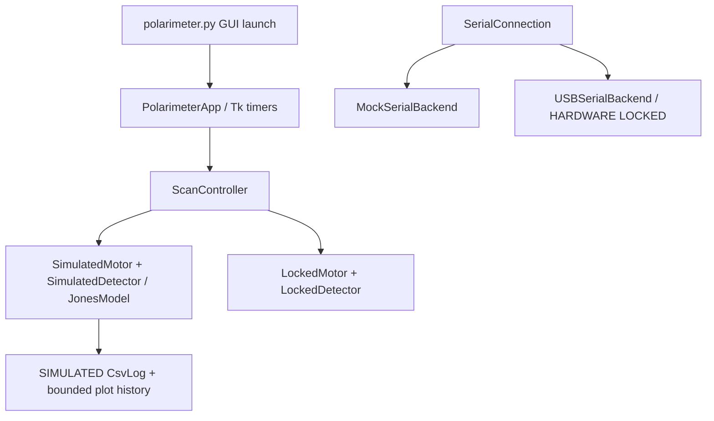

# Phase 2: hardware discovery and integration readiness

Inspection date: 2026-10-27, America/Toronto. Project: `/home/cuqit/polarimeter`.
This phase changes documentation only. All physical communication and motor
locks remain in place. Firmware source and protocol documentation are
unavailable; the plan below does not require requesting them again.

## Motor-driver update, 2026-11-26

The later [ChatGPT hardware handoff](hardware-integration-context.md) is the
canonical source for reported motor identity, encoder identity and driver pin
mapping. See the [Codex response](codex-integration-audit.md) for the source
audit and the distinction between reported details and verified behavior.

The user identified the DC motor driver as **TB6612FNG**. This is a
user-reported component identity; the breakout board, wiring, motor model,
driver channel, supplies and encoder have not been physically verified here.

The [Toshiba datasheet](https://toshiba.semicon-storage.com/info/TB6612FNG_datasheet_en_20141001.pdf?did=10660&prodName=TB6612FNG)
describes two brushed-DC motor channels with direction inputs, PWM inputs and
a shared standby input. The driver has no encoder or angle-reporting interface.
The planned control path is Pi app → ESP32 firmware → TB6612FNG → DC motor;
measured rotation needs a separate feedback path to the controller. Identifying
the driver does not establish ESP32 GPIO assignments, UART commands, speed
calibration, angle calibration or stopping behavior. Existing hardware locks
remain in place; no pins, settings or commands are selected from this update.

## A. Verified hardware and communication interfaces

Inventory was collected with `lsusb`, `lsusb -t`, cached USB/interface sysfs
attributes, `udevadm info`, symlink/ACL checks, `id`, and existing kernel journal
records. No serial, HID measurement or optical instrument port was opened.
No DTR/RTS setting, driver binding, service, permission or hardware state was
changed. No firmware operation or hardware command was performed.

| USB location | Identity and cached strings | Interface / driver | Interpretation |
| --- | --- | --- | --- |
| `1-1.2`, bus 001 device 005 | `10c4:ea60`, Silicon Labs, CP2102 USB to UART Bridge Controller, serial `0001` | One interface `00`, class `ff/00/00`, `cp210x`, 12 Mbit/s USB | USB-UART bridge associated by the user with the ESP32-WROOM-32; USB does not identify the MCU firmware |
| `1-1.1`, bus 001 device 003 | `0eef:0005`, WaveShare, WS170120, serial `220211` | One interface `00`, class `03/00/00`, `usbhid`; HID child uses `hid-multitouch`, 12 Mbit/s USB | Touch input controller; udev marks `/dev/input/event4` as `ID_INPUT_TOUCHSCREEN=1` |
| `1-1`, bus 001 device 002 | `2109:3431`, product USB2.0 Hub | Class `09/00/00`, `hub`, 480 Mbit/s | VIA Labs hub; both peripherals above descend from it |
| `usb1`, bus 001 device 001 | `1d6b:0002`, xHCI Host Controller | USB 2 root hub, `xhci_hcd` in topology | Host infrastructure |
| `usb2`, bus 002 device 001 | `1d6b:0003`, xHCI Host Controller | USB 3 root hub, `xhci_hcd` in topology, 5000 Mbit/s | No downstream USB devices currently shown on this bus |

The speeds above are USB link speeds, **not UART baud rates**. `lsusb`'s vendor
database calls `0eef` D-WAV Scientific; the device's manufacturer string and
udev identify WaveShare. No exact display assembly model is inferred from the
touch-controller identity. Finger operation was previously confirmed by the
user, not by these metadata checks or synthetic GUI tests.

`/dev/hidraw0` maps to the same WaveShare USB interface. The second cached HID
record, `/dev/hidraw1`, has Bluetooth bus ID `0005`, name `Fintie EB327`, a
virtual UHID path and driver `samsung`; it is not another USB instrument.
No `/sys/class/usbtmc` class is present; `usbmisc` contains `hiddev0` and the
only USB serial node is `ttyUSB0` (no `ttyACM*`). No separate optical measurement
device is positively identified in the current USB inventory. This does not
establish what an unconnected instrument might be, or whether the ESP32 can
stream photodiode measurements. No vendor/model, SDK, wavelength setting or
measurement units can be assigned to an optical device from this evidence.

The bridge node is `/dev/ttyUSB0`, `root:dialout`, mode `0660`, with only the
standard owner/group/other ACL entries. The host's active groups include
`dialout`; an effective-ID metadata access check returned read/write access.
The sandbox omits that supplementary group and hides the device node. These
are different execution environments, not a reason to loosen permissions.
Measurement-device permissions cannot be checked until such a device is
identified. No permission changes are indicated for the bridge.

Stable links, all currently resolving to `/dev/ttyUSB0`:

```text
/dev/serial/by-id/usb-Silicon_Labs_CP2102_USB_to_UART_Bridge_Controller_0001-if00-port0
/dev/serial/by-path/platform-fd500000.pcie-pci-0000:01:00.0-usb-0:1.2:1.0-port0
/dev/serial/by-path/platform-fd500000.pcie-pci-0000:01:00.0-usbv2-0:1.2:1.0-port0
```

Prefer by-id only when the serial is unique; serial `0001` must not be assumed
globally unique. By-path binds selection to this USB topology. Revalidate
VID/PID, serial and location together after reconnects; never automatically
open the first matching bridge or trust the changing bus device number.

Recorded kernel evidence from this boot, in local time:

| Time | Existing record |
| --- | --- |
| 09:55:00–09:55:01 | WaveShare `0eef:0005`, WS170120, serial `220211`; touchscreen input and HID registration |
| 12:12:58–12:12:59 | CP2102 at `1-1.2`, serial `0001`, `cp210x` attached as `ttyUSB0` |
| 12:17:31 | USB device 4 disconnected; `cp210x` detached |
| 12:18:24 | Same bridge identity reattached as USB device 5 and `ttyUSB0` |

These are historical journal entries; this inspection did not cause a reconnect
or reset. The log does not identify why the earlier disconnect occurred.
ModemManager and brltty units report `LoadState=not-found`, `ActiveState=inactive`;
the exact-name process check found no ModemManager, brltty, minicom, picocom or
esptool process at inspection time. This snapshot does not guarantee that no
other program could access a port later. No services were started or stopped.

## B. Existing software readiness and assumptions audit

Current connections in the code:



There is no connection between `SerialConnection` and `ScanController` today.
The diagram's two controller branches are selected by explicit simulation
mode; they are not automatic fallback paths.

| Component | What is implemented | What real acquisition still needs |
| --- | --- | --- |
| `polarimeter_gui.py` | `PolarimeterApp` calls controller start/tick/move/jog/stop; Tk timers drive simulation and throttled Canvas updates | Display immutable instrument samples and connection/quality state delivered from workers; continue to gate motion separately from observation |
| `polarimeter_core.Motor` | `angle_deg`, `move_to()`, `stop()` contract | Reviewed motion adapter and measured encoder feedback; acknowledgment alone cannot establish position |
| Encoder | Only a scalar `Motor.angle_deg` property; simulated angle is assigned immediately | Separate feedback records with raw counts, timestamps, calibration, homing/index validity, freshness and fault flags |
| `Detector` | Scalar `read_intensity()` contract; simulated Jones intensity or a locked error | Identify the actual optical device/path and implement a timed measurement adapter with units, exposure/integration interval, calibration and fault reporting |
| `ScanController` | Hard-coded simulated/locked adapters and `_require_simulation()` guards | A separately reviewed asynchronous hardware controller or explicit adapter injection with independent readiness gates; do not enable hardware by changing a mode string |
| `polarimeter_serial.py` | Enumeration-only discovery; opaque framed mock bytes, bounded queues/history, stale/timeout/fault handling and explicit reconnect | A reviewed physical receive path and evidence-based parser; physical connect/read are deliberately unavailable |
| `CsvLog` | Streams simulation-only records, model angle/provenance, arbitrary units | Separate hardware schema and directory with measured angle, device identity, time correlation and validity; never pass hardware records into this logger |
| Legacy CLI | Synthetic time waveform, parser tests and enumeration remain available | Its historical hardware-reader body is unreachable behind the hardware guard; not a usable real adapter |

In `_record()`, `SimulatedMotor.move_to()` sets a model angle immediately and
the detector is read in the same call. This produces model pairs, not evidence
that a real waveplate settled or that two instruments sampled together. The
nominal 20 Hz GUI timer, 2-degree simulated scan steps and 5-degree jog buttons
are UI/model settings, not measured encoder resolution or validated motion
parameters. There is no USB optical library, device-specific measurement API,
trigger coordinator, clock mapping or real encoder parser in the project.
`requirements.txt` is scientific plotting plus pyserial, not an instrument SDK.

Communication assumptions found in the source:

- The legacy CLI requires an explicit baud/format; none is established from
  hardware. Its unreachable reader constructs `serial.Serial(port=None, ...,
  timeout=0.1)`, assigns `dtr=False`, `rts=False`, then would call `open()`.
  The early guard in `main()` rejects this path first. Those assignments were
  not executed here. Keeping them in dormant source is not proof against reset.
- That reader assumes newline-terminated UTF-8 and float/CSV/JSON payloads with
  4096-byte reads. These are historical generic parser choices, not evidence
  about installed firmware. No baud or frame format should be selected from them.
- `Framing` requires a delimiter explicitly. Newline examples and mocked
  numbers such as test baud values describe fixtures only. The 2/10-second
  stale/fault defaults and buffer limits are host mock policy, not observed
  firmware heartbeat timing or motor watchdog behavior.
- `USBSerialBackend` cannot create a serial object. `SerialConnection.connect()`
  independently rejects `HARDWARE LOCKED`; there is no production hardware mode
  or unlock option. There are no serial writes, motor command encoders, encoder
  scaling factors, homing commands or reset commands in the active adapters.
- `LockedMotor.stop()` is a no-op. GUI Stop, transport close and receive timeout
  affect local software only. None is a verified physical emergency stop.

## C. Required physical checks and missing information

Every item below is **unverified** by this software session. A person must
record the actual wiring and component labels. Inspect continuity/wiring only
with all relevant power sources removed; do not infer pins or voltage levels
from a CP2102 USB identifier. No wiring changes or physical tests were made here.

| Check | Evidence to record before the corresponding later experiment |
| --- | --- |
| ESP32 and carrier | Module marking reported as ESP32-WROOM-32; verify carrier revision, connector labels and schematic/pin mapping. CP2102 identity is verified separately from module identity |
| Motor and driver | User reports a DC motor with TB6612FNG driver (2026-11-26); verify the motor model, breakout board, channel, load coupling, terminals, supply voltage/current ratings, grounding and protection |
| Enable/direction/PWM | Trace actual ESP32 pins and driver connections; record logic levels, active polarities, pull states, any step/brake signals, and which outputs can energize the motor during boot. Do not force guessed levels or jumper enable |
| Encoder | Type, connector pinout, supply/logic levels, A/B/index or other interface, pull-ups, shielding/reference ground, shaft coupling/gearing, counts convention, direction and angle-zero reference |
| Reset/boot | Trace CP2102 DTR/RTS to ESP32 EN/boot circuitry and buttons; record any auto-reset components and back-power paths. Do not toggle lines, press reset/boot or reconnect to test this in Phase 2 |
| Motor power isolation | Identify the actual energy disconnect and verify motor power cannot arrive through USB, alternate supplies or signal wiring. A disabled GUI or unplugged USB is not verified motor isolation |
| Emergency stop | Identify a physical stop/power cut independent of Pi software and USB; document latching/restart behavior and how driver outputs de-energize. Later verification must be supervised and separately authorized |
| Optical device/path | Determine whether photodiode data come from ESP32 ADC or a separate USB instrument; record physical device/sensor/controller labels, USB interface, units, range, wavelength/calibration needs and integration/trigger capabilities |
| Position and timing | Counts per waveplate revolution, direction/index/zero, backlash/settling, encoder and detector timestamp clocks, timing resolution, integration duration and acceptable angular error |

USB metadata cannot recover firmware commands, stop semantics, automatic boot
motion, encoder scaling, power isolation, or calibrated optical measurements.
No exact optical instrument model or manufacturer is assumed.

## D. Incremental plan and next validation milestone

The recommended next milestone is **documented motor isolation and a passive
observation readiness review**, followed only in a separately authorized
session by one-way UART observation if the physical checks permit it.
Unavailable firmware source is a known constraint, not a repeated request.

1. **Complete the physical record with power off.** Resolve the checklist above,
   especially motor energy isolation, reset wiring, logic-level compatibility
   and independent stop. Also identify the optical measurement device/path;
   future USB metadata enumeration can identify a connected instrument without
   querying its measurement interface. Record which checks passed and who
   performed them; never mark unknowns verified from a successful USB listing.
2. **Prepare passive observation without opening the CP2102 port.** After physical
   isolation is verified and a later session is explicitly authorized, plan a
   voltage-compatible, high-impedance receive-only monitor of the existing
   ESP32 TX signal and its verified reference. It must have no drive connection
   to ESP32 RX, EN, boot, motor controls, DTR or RTS. Check grounding/isolation
   and loading first; no connection diagram can be prescribed without the
   actual electrical evidence. Do not power-cycle/reset to provoke traffic.
   If the MCU must be powered for capture, the motor energy source must remain
   physically isolated. This capture hardware was not attached or used here.
3. **Analyze captured evidence offline.** Use observed bit timing to derive
   candidate UART settings and preserve raw captures/provenance. Do not sweep
   baud settings on the existing bridge. Identify message boundaries and any
   sequence/timing/checksum fields using repeatable evidence, treating binary
   data, boot text and possible optical/encoder fields as unclassified until
   validated. Silence is a valid outcome; it does not authorize an init request,
   guessed command or reset. Replay fixtures can extend mock/parser tests while
   every hardware control remains locked.
4. **Review a future read-only adapter separately.** The existing physical
   backend must remain locked. Opening CP2102 can affect reset circuitry even
   without application writes; direct USB-UART observation is deferred until
   reset safety, known settings and the established protocol/encoder/safe-stop
   gates are satisfied and a later change is explicitly authorized. Do not
   bypass a lock, set DTR/RTS, or remove the CLI guard to obtain initial data.
   The first authorized observation must have no command/handshake API, no
   automatic reopen and no route into motor control; retain bounded queues,
   raw provenance, explicit connection and fault reporting.
5. **Validate measurement and feedback independently before motion.** Once the
   optical device is identified and access is separately authorized, implement
   its adapter using its confirmed interface. Validate detector units, settings,
   integration interval and stale/error behavior, then encoder counts and
   calibration from independent physical references. Raw bytes and successful
   reads alone cannot establish a valid angle or optical calibration.
6. **Authorize motion only after safety gates pass.** Verified commands,
   homing/limits, measured encoder calibration, stop/watchdog/reset/USB-loss
   behavior and an independent emergency stop are prerequisites. None of these
   tests is part of Phase 2. USB attachment, transport connection or a mock
   test must never automatically enable Start/Go/Jog.

No present command is supplied to open an instrument. The GPIO pins, voltages,
UART baud, frame format, command bytes, scaling factors and driver polarities
remain unspecified. This plan is not evidence of completed physical isolation,
capture, calibration or stop testing.

## Planned synchronization and architecture changes

Start real acquisition with **move, verify settling, then measure**; continuous
rotation needs a later timing validation. Future controller behavior should be:

1. Submit a verified move through a gated motor adapter; keep requested angle
   separate from measured encoder angle. A command acknowledgment is not arrival.
2. Wait for fresh, calibrated encoder feedback within a validated angle band for
   a measured settling interval. Establish tolerances from hardware evidence.
3. Acquire optical data whose known integration window lies within the settled
   interval; account for buffered readings and detector latency. Associate the
   measurement with encoder samples spanning that interval. Reject or flag
   stale, unstable, out-of-range or unmatched records.
4. Stream immutable hardware records through a bounded worker queue into a
   separate hardware logger; Tk should only consume snapshots/update widgets.
   Stop scheduling acquisition and latch faults on missing feedback, disconnect,
   timeout, overflow or logging errors. Physical stopping requires the verified
   stop path and independent watchdog/power cut, not the current local no-op.

The current scalar `Detector.read_intensity()` and `Motor.angle_deg` are
insufficient for timing evidence. A future sample contract needs session/sample
IDs, source device identity, raw encoder counts, calibrated measured angle and
calibration version, optical value/unit/settings, device timestamps and clock
domain, host monotonic receipt times, exposure start/end (or bounds), sequence
numbers, timing uncertainty and validity/fault flags. Keep a UTC anchor for
human traceability. Preserve raw evidence and keep simulation records separate.

For continuous rotation, prefer a validated common trigger or encoder latch
at the detector's actual sample/integration timing if both instruments support
it. Otherwise measure device-to-host clock offset, drift and transport latency;
do not equate USB arrival time or a Tk callback with exposure time. A timing
error `delta_t` corresponds approximately to `angular_speed * delta_t` angle
error during steady rotation. Set and verify an error budget from the required
angular accuracy. If timestamps/triggers cannot meet it, keep acquisition at
verified stationary positions. These are design proposals, not implemented
synchronization or measured capabilities of an unidentified optical device.

## E. Automated verification

Executed on the Pi desktop after inspection:

```bash
cd /home/cuqit/polarimeter
POLARIMETER_GUI_TESTS=1 .venv/bin/python -B -m unittest discover -v
```

Result: **49 tests passed, zero failures/errors/skips**, reported test time
6.643 seconds. This includes the five mapped Tk tests, 21 serial mock/lock
tests, optics/controller/CSV/legacy tests and six desktop-health tests. GUI
button events are synthetic; no motor, encoder, optical device, USB measurement
stream, physical serial link or synchronized hardware acquisition was tested.

SHA-256 comparison with the start-of-phase snapshot confirmed all 11 Python
source/test files unchanged. Their AST syntax checks passed, as did documentation
local-link, code-fence and whitespace checks and `git diff --check`.

## F. Files changed in Phase 2

- `docs/hardware-readiness.md`: this hardware inventory, source audit, physical
  checklist, staged observation plan, synchronization design and test result.
- `docs/usb-serial-integration.md`: link to readiness evidence and updated next
  milestone for the known absence of firmware source/documentation.
- `README.md`: readiness summary/link and clarification of the acquisition lock.

Python source, all existing tests, dependency files and hardware locks were
left unchanged. Phase 1 files/edits already present in the working tree were
preserved; they are not new Phase 2 code changes. No commit or push was made.
